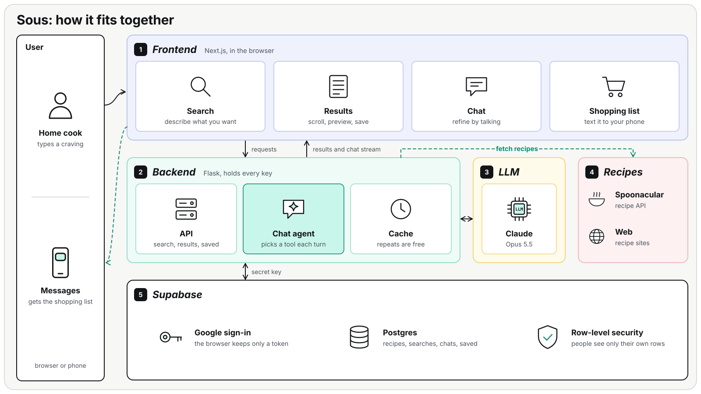
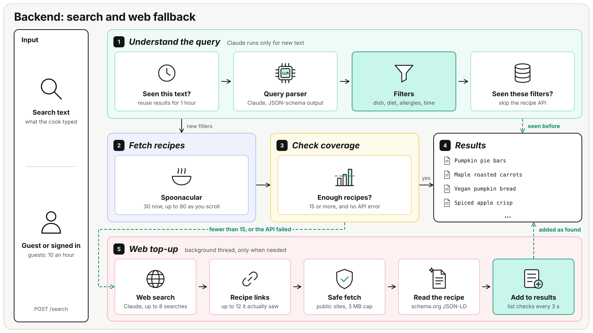
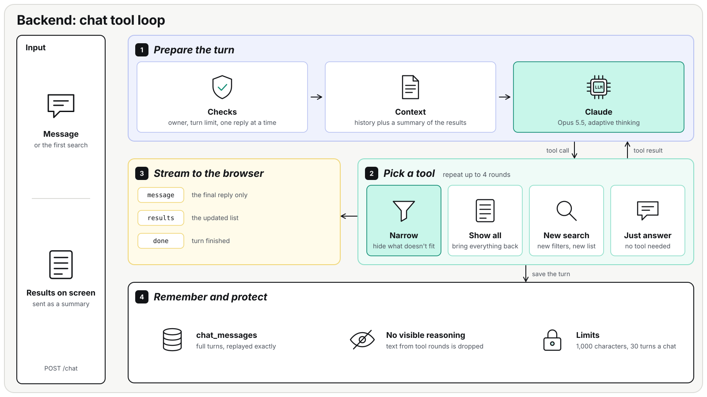
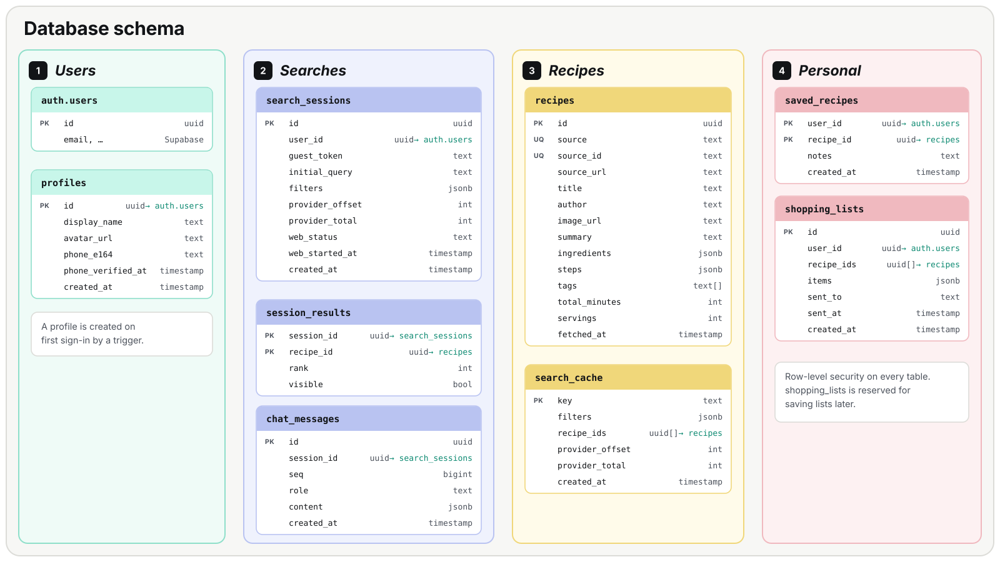

<a id="readme-top"></a>

<div align="center">
  <h1>sous-svc</h1>

  <p>
    The Flask backend for Sous: Claude calls and the chat tool loop, recipe providers, web fallback and Supabase data access.
    <br />
    <a href="https://github.com/hanyjasmine/sous-chef"><strong>See the frontend »</strong></a>
    <br />
    <br />
    <a href="https://github.com/hanyjasmine/sous-svc/issues/new?labels=bug">Report Bug</a>
    &middot;
    <a href="https://github.com/hanyjasmine/sous-svc/issues/new?labels=enhancement">Request Feature</a>
  </p>
</div>

<details>
  <summary>Table of Contents</summary>
  <ol>
    <li>
      <a href="#about-the-project">About The Project</a>
      <ul>
        <li><a href="#architecture">Architecture</a></li>
        <li><a href="#built-with">Built With</a></li>
      </ul>
    </li>
    <li>
      <a href="#getting-started">Getting Started</a>
      <ul>
        <li><a href="#prerequisites">Prerequisites</a></li>
        <li><a href="#installation">Installation</a></li>
      </ul>
    </li>
    <li>
      <a href="#usage">Usage</a>
      <ul>
        <li><a href="#endpoints">Endpoints</a></li>
        <li><a href="#result-pool-and-cache">Result pool and cache</a></li>
        <li><a href="#web-top-up">Web top-up</a></li>
        <li><a href="#chat">Chat</a></li>
        <li><a href="#feature-flags">Feature flags</a></li>
      </ul>
    </li>
    <li><a href="#testing">Testing</a></li>
    <li><a href="#roadmap">Roadmap</a></li>
    <li><a href="#license">License</a></li>
    <li><a href="#contact">Contact</a></li>
    <li><a href="#acknowledgments">Acknowledgments</a></li>
  </ol>
</details>

## About The Project

sous-svc is the backend behind [Sous](https://github.com/hanyjasmine/sous-chef), a recipe finder you talk to. The Next.js frontend never calls Claude, the recipe API or the database directly. It proxies `/api/svc/*` here, and this service:

- turns a plain-English request into structured search filters with Claude
- fetches recipes from Spoonacular, and from recipe sites across the web when that comes back thin
- caches result pools so repeat searches cost nothing
- runs the chat, where Claude narrows the current results or starts a new search
- stores sessions, recipes, chats and saved recipes in Supabase Postgres

<p align="right">(<a href="#readme-top">back to top</a>)</p>

### Architecture

<picture>
  <source media="(prefers-color-scheme: dark)" srcset="docs/images/architecture-dark.svg">
  
</picture>

The backend is the hub. It checks the user's Supabase token against Supabase's public signing keys, calls Claude, Spoonacular and recipe websites, and writes to Postgres with the secret key.

#### Search and web fallback

<picture>
  <source media="(prefers-color-scheme: dark)" srcset="docs/images/search-pipeline-dark.svg">
  
</picture>

Two caches sit in front of the paid calls. The exact query text is checked before Claude runs, since the parser can word the same request slightly differently each time. The parsed filters are checked before Spoonacular. When fewer than 15 recipes come back, a background job fills in from the web while the first results are already on screen.

#### Chat tool loop

<picture>
  <source media="(prefers-color-scheme: dark)" srcset="docs/images/chat-loop-dark.svg">
  
</picture>

Claude sees a short summary of the results on screen and picks a tool each round, up to 4 rounds a turn. Only the final reply is streamed, so nothing Claude writes while working shows up in the chat.

#### Database schema

<picture>
  <source media="(prefers-color-scheme: dark)" srcset="docs/images/schema-dark.svg">
  
</picture>

Every recipe is stored once in `recipes`, whatever its source, and searches point at it through `session_results`. Row-level security is on for every table.

<p align="right">(<a href="#readme-top">back to top</a>)</p>

### Built With

* [![Python][Python]][Python-url]
* [![Flask][Flask]][Flask-url]
* [![Claude][Claude]][Claude-url]
* [![Pydantic][Pydantic]][Pydantic-url]
* [![Supabase][Supabase]][Supabase-url]
* [![Spoonacular][Spoonacular]][Spoonacular-url]

<p align="right">(<a href="#readme-top">back to top</a>)</p>

## Getting Started

### Prerequisites

* Python 3.12 or newer
* [uv](https://docs.astral.sh/uv/)
  ```sh
  curl -LsSf https://astral.sh/uv/install.sh | sh
  ```
* API keys for [Anthropic](https://console.anthropic.com) and [Spoonacular](https://spoonacular.com/food-api)
* A Supabase project (its URL and secret key)

### Installation

1. Clone the repo
   ```sh
   git clone https://github.com/hanyjasmine/sous-svc.git
   cd sous-svc
   ```
2. Install dependencies
   ```sh
   uv sync
   ```
3. Create `.env` from the example and fill in your keys
   ```sh
   cp .env.example .env
   ```
   ```sh
   ANTHROPIC_API_KEY=
   SUPABASE_URL=
   SUPABASE_SECRET_KEY=
   SPOONACULAR_API_KEY=
   ```
4. Apply the database schema in `supabase/migrations/`, either with the Supabase CLI or by pasting each file into the SQL editor in order
   ```sh
   supabase db push
   ```
5. Run the service
   ```sh
   uv run flask --app sous_svc run --port 5001 --debug
   ```

Port 5001 because macOS AirPlay holds 5000. The frontend reads `SOUS_SVC_URL` (default `http://127.0.0.1:5001`). Without Supabase settings the service falls back to an in-memory store.

<p align="right">(<a href="#readme-top">back to top</a>)</p>

## Usage

### Endpoints

| Method | Path | Notes |
|---|---|---|
| `GET` | `/health` | Status and feature flags |
| `POST` | `/search` | `{"query": "..."}`. Claude turns the query into Spoonacular filters, then a pool of up to 30 recipes is fetched (or reused from the cache) and stored as a session. Returns the first page. `429` when the Spoonacular daily quota is used up |
| `GET` | `/sessions/<id>` | Session plus the first page of its current view |
| `GET` | `/sessions/<id>/results?cursor=N` | Next page of the view. Scrolling past the pool pulls 20 more from Spoonacular, up to 90 per session |
| `GET` | `/sessions/<id>/messages` | Chat history as display bubbles |
| `POST` | `/sessions/<id>/chat` | `{"greet": true}` once to open with the original query, then `{"message": "..."}`. Streams server-sent events: `message`, `results` (a new first page), `error`, `done` |
| `GET` | `/saved` | Signed-in user's saved recipes |
| `PUT` | `/saved/<recipe_id>` | Save a recipe |
| `DELETE` | `/saved/<recipe_id>` | Remove a saved recipe |

Send the user's Supabase access token as `Authorization: Bearer <token>`. Guests can search and chat within hourly limits (`GUEST_SEARCHES_PER_HOUR`, `GUEST_CHAT_TURNS_PER_HOUR`).

### Result pool and cache

- A search builds a pool of up to 30 recipes. The view is the whole pool, or a subset the chat narrowed it to.
- Pools are cached for an hour, keyed by both the query text and a hash of the parsed filters (`search_cache`), so a repeat search costs no Claude call and no Spoonacular points. An hour is Spoonacular's caching limit, and sessions expire on the same `SESSION_TTL_SECONDS`.
- A 30-result search costs a few Spoonacular points (full recipe info is charged per result). The free plan has 50 points a day.

### Web top-up

When Spoonacular returns fewer than `WEB_TOPUP_BELOW` recipes (15), or fails outright (quota used up or down), a background job fills in the pool from the web:

1. Claude runs a web search and submits up to 12 recipe page URLs.
2. Sous fetches each page itself and reads its schema.org `Recipe` JSON-LD.
3. Pages without a title, at least 2 ingredients and steps are skipped.

The session reports `webPending: true` while the job runs, and the frontend polls `/results` until it's done. Fetches only go to public addresses, re-checked on every redirect, and stop at 3 MB. The finished pool, web results included, goes into the search cache.

Each top-up costs a Claude call with web search (searches are billed per use, plus tokens) and takes about 20-30 s. Turn it off with `WEB_SEARCH_FALLBACK_ENABLED=false`. `WEB_SEARCH_MODEL` overrides the model used for it.

Web recipes are stored with a link back to the original page and its author or site name. That's fine for personal use, but check each site's terms before Sous goes public.

### Chat

Each turn, Claude gets the pool as a mid-conversation system message (only when it changed) and picks one of three tools:

- `narrow_results`: shows a subset of the pool. Free.
- `show_all_results`: undoes the narrowing.
- `new_search`: replaces the pool. Spends points.

Claude can make up to 4 calls per turn. Full content blocks (including thinking) are stored in `chat_messages`, so history replays exactly. Guests are limited by `GUEST_CHAT_TURNS_PER_HOUR`, and each chat is capped at 30 turns.

### Feature flags

| Flag | Default | Notes |
|---|---|---|
| `WEB_SEARCH_FALLBACK_ENABLED` | `true` | Claude web search + schema.org JSON-LD when the recipe API comes back thin |
| `NYT_MCP_ENABLED` | `false` | NYT Cooking search via the unofficial `nyt-cooking-mcp` server |
| `NYT_MCP_FULL_RECIPES` | `false` | Full NYT ingredients/steps. Personal use only; keep off on any public deploy |

<p align="right">(<a href="#readme-top">back to top</a>)</p>

## Testing

```sh
uv run pytest
uv run ruff check .
```

Tests use an in-memory store and fake providers, so they never call Claude, Spoonacular or the web.

<p align="right">(<a href="#readme-top">back to top</a>)</p>

## Roadmap

- [x] Natural-language search with Claude
- [x] Spoonacular provider with paging and a one-hour pool cache
- [x] Chat tool loop: narrow, show all, new search
- [x] Web top-up from schema.org recipe pages
- [x] Saved recipes
- [ ] SMS shopping lists through Twilio
- [ ] NYT Cooking through MCP

See the [open issues](https://github.com/hanyjasmine/sous-svc/issues) for more.

<p align="right">(<a href="#readme-top">back to top</a>)</p>

<!-- ## License

No license has been chosen yet, so all rights are reserved for now.

<p align="right">(<a href="#readme-top">back to top</a>)</p>

## Contact

hanyjasmine - [@hanyjasmine](https://github.com/hanyjasmine)

Backend: [https://github.com/hanyjasmine/sous-svc](https://github.com/hanyjasmine/sous-svc)
<br />
Frontend: [https://github.com/hanyjasmine/sous-chef](https://github.com/hanyjasmine/sous-chef)

<p align="right">(<a href="#readme-top">back to top</a>)</p>

## Acknowledgments

* [Anthropic Claude API](https://docs.anthropic.com) for parsing, chat and web search
* [Spoonacular](https://spoonacular.com/food-api) for recipe data
* [schema.org Recipe](https://schema.org/Recipe) for structured recipe pages
* [Supabase](https://supabase.com) for auth and Postgres
* [Best-README-Template](https://github.com/othneildrew/Best-README-Template) for this README's layout

<p align="right">(<a href="#readme-top">back to top</a>)</p> -->

<!-- MARKDOWN LINKS & IMAGES -->
[Python]: https://img.shields.io/badge/Python_3.12-3776AB?style=for-the-badge&logo=python&logoColor=white
[Python-url]: https://www.python.org/
[Flask]: https://img.shields.io/badge/Flask-000000?style=for-the-badge&logo=flask&logoColor=white
[Flask-url]: https://flask.palletsprojects.com/
[Claude]: https://img.shields.io/badge/Claude-D97757?style=for-the-badge&logo=claude&logoColor=white
[Claude-url]: https://www.anthropic.com/claude
[Pydantic]: https://img.shields.io/badge/Pydantic-E92063?style=for-the-badge&logo=pydantic&logoColor=white
[Pydantic-url]: https://docs.pydantic.dev/
[Supabase]: https://img.shields.io/badge/Supabase-1C1C1C?style=for-the-badge&logo=supabase&logoColor=3ECF8E
[Supabase-url]: https://supabase.com/
[Spoonacular]: https://img.shields.io/badge/Spoonacular_API-4CAF50?style=for-the-badge
[Spoonacular-url]: https://spoonacular.com/food-api
